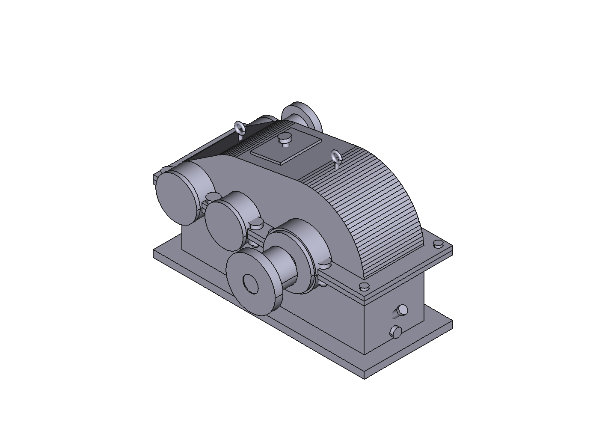
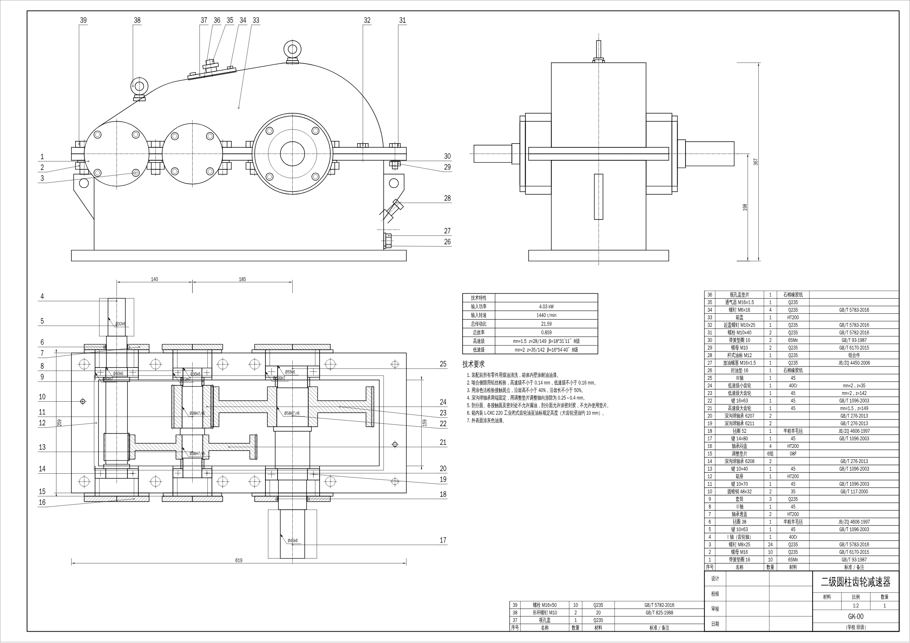

# 工科工作台（GongKe Workbench）

面向中国机械类学生的开源课程设计工作台。第一版做的是最常见的题目：**带式输送机用展开式二级斜齿圆柱齿轮减速器**。

输入一张设计任务书（输送带拉力、速度、卷筒直径、使用年限），一次得到：

- **全部设计计算**：电动机选择、传动比分配、各轴运动和动力参数；两级斜齿轮按接触强度设计、按弯曲强度定模数、圆整中心距后校核；三根轴的结构设计、受力分析、弯扭合成校核；深沟球轴承寿命；平键挤压强度；箱体主要尺寸；润滑方式。
- **三维装配体（STEP）**：渐开线斜齿轮（大齿轮为腹板式）、带键槽的阶梯轴、齿轮轴、轴承、联轴器半体、箱座、箱盖、轴承盖、连接螺栓和主要附件。可直接在 FreeCAD、SolidWorks、UG 中打开。
- **二维工程图（DXF，附 SVG 预览）**：装配图（主视图、俯视剖视图、左视图，画出箱盖、轴承盖、连接螺栓、视孔盖、通气器、吊环螺钉、油标、放油螺塞等附件，零件序号、明细栏、技术特性表、技术要求），三根轴和各齿轮的零件图（尺寸和配合代号、键槽断面图、表面结构、基准和圆跳动、齿轮参数表），按 GB 图幅、比例、图线和标题栏绘制。可用 AutoCAD、中望 CAD、LibreCAD 等打开修改。
- **计算说明书（Word / Markdown）**：每一步写出公式、代入值和结论，附各轴弯矩图、转矩图和校核汇总表。





改任何一个参数，后面的齿轮、轴、轴承、键、模型、说明书全部重算。

## 使用方法

### 方式一：FreeCAD 工作台

1. 安装 FreeCAD 1.0 或更新版本。
2. 把本仓库放到 FreeCAD 的插件目录，命名为 `gongke-workbench`（FreeCAD 1.0：Linux 为 `~/.local/share/FreeCAD/Mod/`，Windows 为 `%APPDATA%\FreeCAD\Mod\`；1.1 起多一层版本目录，如 `v1-1/Mod/`）。
3. 给 FreeCAD 自带的 Python 装上依赖（也可以用任意一个装好依赖的 Python 3.10+）：
   ```
   <FreeCAD 安装目录>/bin/python -m pip install build123d python-docx pyyaml ezdxf
   ```
4. 启动 FreeCAD，切换到“工科工作台”，菜单 **工科 → 设置 Python 解释器…** 选中上一步的 Python。
5. 点工具栏图标打开“二级圆柱齿轮减速器设计”，填参数，点“开始设计”。约 1 分钟后装配体导入当前文档，面板里列出校核结果，以及说明书和各张工程图的链接。

### 方式二：命令行

```
pip install pyyaml python-docx pillow build123d ezdxf
python -m gongke_core design examples/conveyor_basic.yaml -o out
```

`out/` 下得到 `summary.json`、`report.docx`、`report.md`（含弯矩图）、`reducer_assembly.step` 和 `drawings/`（`assembly.dxf`、`shaft1.dxf`…、`gear_low2.dxf` 等，每张都有同名 SVG 预览）。三维模型默认把齿轮画成齿顶圆柱（约 1 MB），加 `--full-teeth` 建出完整渐开线齿形（约 30 MB）；`--no-step`、`--no-drawings` 可跳过对应输出。任务书格式见 [examples/conveyor_basic.yaml](examples/conveyor_basic.yaml)，教材里查图得到的系数可以在 `overrides` 中填写，覆盖程序的近似值。

## 计算方法和数据

- 计算按濮良贵《机械设计》（第八版）和课程设计指导书的方法，每个公式在代码注释和说明书中都写明出处。
- 教材中只能查图的系数（动载系数 Kv、寿命系数 KHN/KFN）用 ISO 6336 的解析近似，说明书里会提示，并可在任务书中手工覆盖。
- 只录入计算链路必须用到的少量标准数据（Y 系列电动机、深沟球轴承、平键、模数、齿形系数），存放在 `data/`，每个文件注明标准号，状态为“待人工核对”。

详细的分层和取舍见 [docs/architecture.md](docs/architecture.md)。

## 目前的限制

- 只支持“电动机 → 联轴器 → 展开式二级斜齿圆柱齿轮减速器 → 联轴器 → 卷筒”这一种方案。V 带、锥齿轮、蜗杆方案是下一步。
- 轴的校核为弯扭合成法，尚未做考虑应力集中的安全系数法精确校核。
- 箱体是简化模型：轴承座为圆柱凸台，没有加强肋；附件按常用尺寸示意，型号需按手册核对。
- 联轴器只给出计算转矩和孔径，型号需按 GB/T 5014 自行核对。
- 工程图是按设计数据直接绘制的“规定画法”，不是从三维模型投影：主视图、左视图只画外形（不作局部剖），地脚螺栓孔未画；零件图的倒角、圆角用技术要求统一说明。作为底稿使用，提交前请按指导书补全。
- 工程图字体按 Windows 的仿宋（simfang.ttf）设置；FreeCAD 自带的 DXF 导入只导入线条，不导入文字和尺寸，看完整图纸请用 CAD 软件或 SVG 预览。
- 没有 PDF 输出（避免引入 AGPL 许可的依赖），可在 CAD 软件中打印为 PDF。

## 测试

```
pytest -q                          # 计算、数据、三维建模、命令行（约 2 分钟）
tests/e2e/run_freecad_e2e.sh       # 下载 FreeCAD，在 Xvfb 下跑界面端到端测试
```

## 许可证

LGPL-2.1-or-later，与 FreeCAD 一致。
